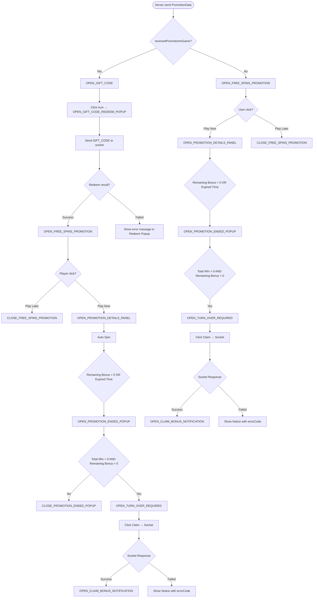

# 🎰 Free Spins Bonus Promotion Flowchart (Mermaid)

This document describes the complete flow of the Free Spins Bonus Promotion system, including both In-Game and In-Lobby paths.  
The flow captures key events such as gift code redemption, promotion panels, auto spin, end popup, turnover requirements, and claim notifications.

---

## 🧭 Flowchart

---

## 📌 Notes

✅ **OPEN_GIFT_CODE**: Only shown in In-Game mode

🔁 **OPEN_FREE_SPINS_PROMOTION**: Triggered after redeem (In-Game) or immediately (In-Lobby)

▶️ **OPEN_PROMOTION_DETAILS_PANEL**: Opened when user selects “Play Now”

⏳ **OPEN_PROMOTION_ENDED_POPUP**: Shown when bonus runs out or expires

📈 **OPEN_TURN_OVER_REQUIRED**: Shown if player wins and uses all bonus spins

💰 **OPEN_CLAIM_BONUS_NOTIFICATION**: Triggered after successful claim

❌ **Show Notice with errorCode**: Triggered when redeem or claim fails

---

## ⚠️ Additional Rules

🌀 Extra Free Spins during the bonus promotion spins are still considered part of the bonus promotion and will auto-play immediately.

🎟️ Extra Free Spins from normal ticket spins (not bonus promotion) must be played first before the user plays gift code.

⏱️ Promotion has expiration and must be claimed within the defined period or it will be voided.

🎮 Auto Spin will begin automatically if the player selects “Play Now” during bonus.

